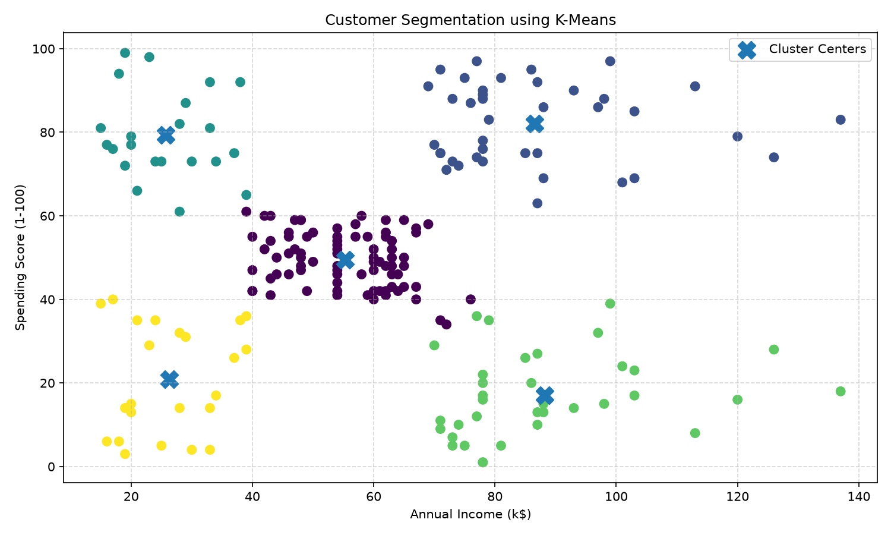
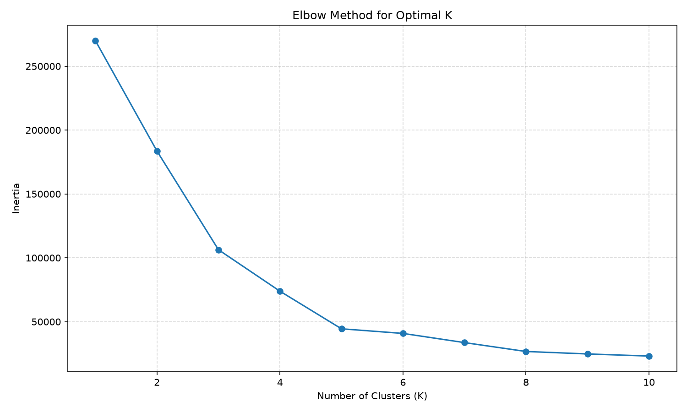

# Customer Segmentation using K-Means Clustering

## Overview

This project implements a K-Means Clustering algorithm to group mall customers based on their annual income and spending score.

The goal is to identify different customer segments that have similar purchasing behavior.

## Dataset

The project uses the Mall Customers dataset.

The dataset contains the following columns:

- CustomerID
- Gender
- Age
- Annual Income (k$)
- Spending Score (1-100)

For clustering, the following two features are used:

- Annual Income (k$)
- Spending Score (1-100)

## Technologies Used

- Python
- Pandas
- Scikit-learn
- Matplotlib
- K-Means Clustering

## Methodology

The project follows these steps:

1. Load the Mall Customers dataset.
2. Select Annual Income and Spending Score as features.
3. Use the Elbow Method to determine a suitable number of clusters.
4. Select K = 5 based on the Elbow Method.
5. Apply K-Means Clustering.
6. Assign each customer to a cluster.
7. Visualize the customer clusters.
8. Save the generated graphs.

## Elbow Method

The Elbow Method is used to determine a suitable number of clusters.

The inertia decreases significantly as the number of clusters increases up to around K = 5. After this point, the improvement becomes smaller.

Therefore, K = 5 was selected for the K-Means model.

## Results

The K-Means algorithm divides the customers into 5 clusters based on their annual income and spending score.

### Customer Clusters



### Elbow Method



## Project Structure

```text
SCT_ML_2
│
├── data
│   └── Mall_Customers.csv
│
├── src
│   └── customer_segmentation.py
│
├── customer_clusters.png
├── elbow_method.png
├── README.md
└── requirements.txt